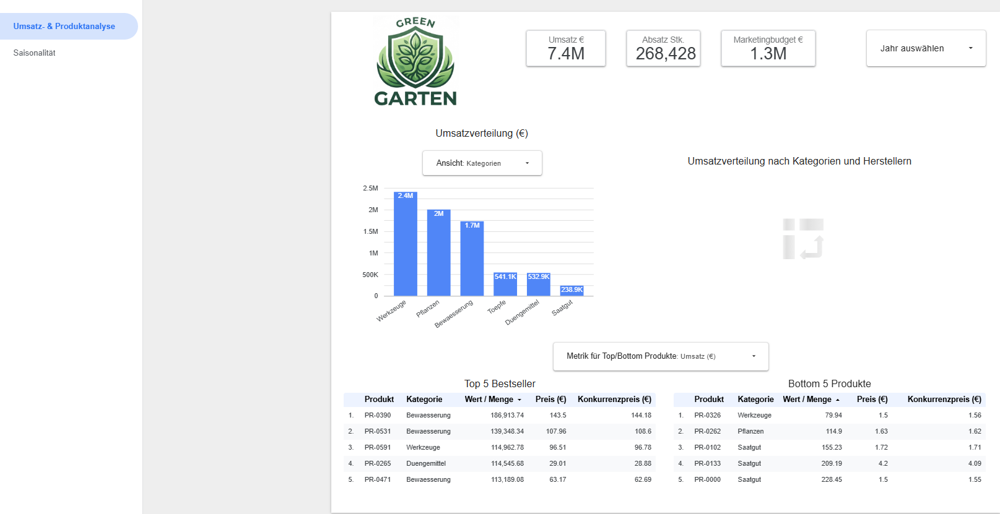
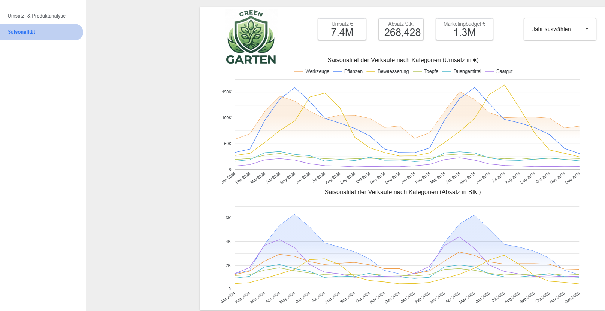

# Umsatzprognose GreenGarten (Datenanalyse & Dashboard)

Dieses Repository enthält den Analyseteil unseres 3-köpfigen IHK-Projekts für die *GreenGarten Versandhandel GmbH* (Online-Händler für Gartenprodukte mit ca. 3,7 Mio. EUR Jahresumsatz).

## 🏢 Unternehmenskontext & Problemstellung
Bisher plant der Einkauf Bestellmengen und Lagerbestände manuell über Excel-Vorjahresvergleiche. Das führt zu Problemen wie Stockouts in der Hochsaison oder Kapitalbindung durch Überbestände. Das Ziel dieses Projekts ist die fundierte Analyse der historischen Verkaufs- und Marketingdaten mittels explorativer Datenanalyse (EDA), um die wesentlichen Umsatztreiber und Saisonnmuster aufzudecken.

## 👥 Meine Aufgaben & Arbeitsteilung

* **Team:** 3 Personen (IHK-Abschlussprojekt Data Analyst)

**Mein Verantwortungsbereich (dieses Repository):**
1. **Explorative Datenanalyse (EDA):** Untersuchung der Umsatzstrukturen nach Kategorien, Herstellern, Preisen und Saisonalität (`src/eda.ipynb`).
2. **Marketing-Analyse:** Überprüfung des Zusammenhangs zwischen Werbeausgaben und Umsatz.
3. **Dashboard:** Entwicklung des interaktiven Dashboards in Looker Studio für die Geschäftsführung und alle relevanten Abteilungen.

*(Die Datenbereinigung und der Bereich Machine Learning wurden von anderen Teammitgliedern bearbeitet).*

## 📈 Zentrale Ergebnisse der EDA
* **Sortiment & Preisstruktur:** Das Sortiment umfasst 600 Produkte in 6 Kategorien und bei 6 Lieferanten (darunter 181 Pflanzen und 115 Werkzeuge). Die Preisspanne reicht von 1,50 € bis 143,50 €. Gestützt auf die Quartile (Q1 bei 8,13 €, Median bei 20,64 €, Q3 bei 34,66 €) wurden drei klare Preissegmente definiert: Basisprodukte reichen bis 10 €, Standardprodukte bis 35 €, und alles darüber fällt in das Premium-Segment. Statistische Ausreißer (zwei bei Werkzeugen, einer bei Pflanzen) spiegeln exklusive Spezialprodukte wider.
* **Umsatzstrukturen & Kategorien:** Werkzeuge, Pflanzen und Bewässerungssysteme machen über 82 % des Gesamtumsatzes aus. Preislich dominiert das Premium-Segment (> 35 €) mit 56 % des Umsatzes, dicht gefolgt vom Standard-Segment mit knapp 40 % (Basisprodukte liegen unter 5 %). Bewässerung und Werkzeuge sind die teuersten Kategorien mit der größten Preisspanne, während Saatgut die günstigste Kategorie bildet.
* **Hersteller-Performance:** *Hortica* nimmt mit über 21 % am Gesamtumsatz die Spitzenposition ein (allein im Bereich Bewässerung generiert Hortica knapp 10 % des Gesamtumsatzes). *Vivero* belegt den letzten Platz (knapp 14 %), während *BioGruen* und *Floraplan* wesentliche Umsätze im Werkzeugsegment beisteuern.
* **Saisonalität:** Stark ausgeprägter Saisonverlauf mit einem Peak im Frühsommer (Mai/Juni) und Jahrestief im Januar, getrieben vor allem durch die Hauptkategorien.
* **Marketingkorrelation:** Ein sehr hoher Zusammenhang ($r = 0,96$) zwischen Werbeausgaben und Umsatz zeigt, dass das Budget synchron zum Saisonauftakt verläuft. Dies beweist keinen direkten Werbeeffekt, sondern zeigt, dass das Unternehmen historische Werte nutzt, um starke Saisons gezielt einzuplanen und den Vorsprung vor der Konkurrenz zu halten.

## 🖥️ Dashboard
Das interaktive Dashboard zur Visualisierung der Ergebnisse wurde in **Data Studio (Looker Studio)** erstellt:
👉 [Data Studio Dashboard öffnen](https://datastudio.google.com/reporting/9622854a-b558-40ac-840c-e09c26d4eca7)

### Dashboard-Funktionalität & Beschreibung
Das in Looker Studio entwickelte interaktive Dashboard dient der detaillierten visuellen Analyse der Geschäftstätigkeit von *GreenGarten* und wird von allen relevanten Abteilungen genutzt. Es gliedert sich in zwei Hauptbereiche (Tabs):

*(Beispiel: Ansicht der Umsatz- & Produktanalyse)*

**1. Tab: Umsatz- & Produktanalyse**
* **KPI-Header:** Zeigt globale Kennzahlen (Umsatz, Absatz, Marketingbudget) mit flexibler Filteroption zur Jahresauswahl (z. B. 2025: ca. 3,7 Mio. € Umsatz, knapp 134.000 Absatz, über 645.000 € Marketingbudget).
* **Umsatzverteilung & Ansicht-Filter:** Ein Balkendiagramm, bei dem über das Dropdown-Menü drei Darstellungsformen gewählt werden können: nach **Kategorien**, **Herstellern** (z. B. Spitzenreiter *Hortica*) oder **Preislagen** (wobei das Basissegment unter 5 % ausmacht).
* **Heatmap (Kategorien & Hersteller):** Eine Kreuztabelle, die mithilfe einer Farbcodierung (dunkle Töne für maximalen Umsatz, helle für geringeren) die Umsatzverteilung zwischen Lieferanten und Warengruppen visualisiert (z. B. *Hortica* führt bei Bewässerung, *Biogrün* und *Floraplan* bei Werkzeugen).
* **Top-5 & Bottom-5 Produkte:** Tabellen mit Produktinformationen sowie unserem Preis im Vergleich zum Konkurrenzpreis (hilfreich für die Marketingabteilung). Über ein Dropdown-Menü kann die Kennzahl flexibel zwischen **Umsatz (€)** und **Absatz in Stück** (besonders wichtig für den Einkauf) umgeschaltet werden.
* **Interaktive Kreuzfilterung:** Das Dashboard fungiert vollständig als interaktiver Filter – durch Anklicken spezifischer Zellen (z. B. Kombination aus *Hortica* und *Bewässerung*) werden die Daten dynamisch gefiltert.

*(Beispiel: Ansicht der Saisonalitätsanalyse)*

**2. Tab: Saisonalität**
* **Saisonalitätsanalyse nach Kategorien:** Zwei detaillierte Liniendiagramme zur Untersuchung des Saisonverlaufs nach Umsatz (€) und Absatz (Stk.).
* **Erkenntnisse:** Zeigt auf, dass die Top-3-Kategorien die Haupt-Saisonpeaks im Umsatz ausmachen, während beim Absatz (Stk.) beispielsweise Saatgut im April einen extremen Peak aufweist, was den hohen Anteil des Basissegments bei Saatgut im Vergleich zum Premiumsegment (Werkzeuge/Bewässerung) widerspiegelt.

## 🛠️ Tech Stack
* **Entwicklungsumgebung:** VS Code, Jupyter Notebook (`src/eda.ipynb`)
* **Programmiersprache:** Python
* **Bibliotheken:** Pandas, NumPy, Matplotlib, Seaborn
* **Dashboard:** Google Data Studio
* **Versionsverwaltung:** Git & GitHub

## 📂 Repository-Struktur
* `raw/` – Ursprüngliche Rohdaten
* `interim/` – Bereinigte Daten (`verkaufe_clean.csv`)
* `src/` – Jupyter Notebooks (`data_cleaning.ipynb`, `eda.ipynb`)
* `screenshots/` – Ansichten des Looker/Data Studio Dashboards (`tab1.png`, `tab2.png`)
